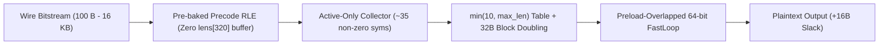

# picoflate

**Sub-microsecond, zero-allocation C++23/26 RFC 1951 Raw Deflate (`wbits = -15`) decompressor engineered from first principles for small-packet streaming (`100 B – 16 KB`).**

[English](README.md) | [简体中文](README.zh-CN.md)

[](LICENSE)
[](include/picoflate/picoflate.h)
[](include/picoflate/picoflate.h)

---

## First-Principles Motivation: Why `libdeflate` & `zlib` Hit a Wall on Sub-Kilobyte Frames

General-purpose DEFLATE engines (`zlib`, `zlib-ng`, `libdeflate`) optimize for **asymptotic bulk throughput** ($\text{MB/s}$ on $\ge 64\text{ KB}$ files):

$$T_{\text{total}}(N) = T_{\text{tree}} + N \cdot c_{\text{token}}$$

When $N \ge 64\text{ KB}$, Dynamic Huffman table construction ($T_{\text{tree}} \approx 1.1\text{ }\mu\text{s}$) is amortized to $< 1\%$ of total runtime.

In real-time streaming protocols — stateless WebSocket `permessage-deflate` (`server_no_context_takeover`), exchange L2 order-book incremental diffs, and RPC/JSON micro-messages ($N \in [100\text{ B}, 2\text{ KB}]$) — **the physics invert completely**:

1. **Every single frame carries its own `btype = 2` Dynamic Huffman header.** Dissecting a real mainnet BTC L2 order-book diff (`207 B` compressed $\to$ `563 B` JSON):
   - The Dynamic Huffman header consumes **`311 bits` (`38.9 B` = `18.8%` of the wire packet)**.
   - The payload contains only **`178` literals + `42` short LZ77 matches** (`~361 ns` of actual token decoding).
2. **87% of the RFC 1951 alphabet is dead space.** In typical JSON/ASCII micro-frames, only **`35 / 268` (`13%`)** literal/length symbols (`max_len = 8`) and **`10 / 19`** distance symbols (`max_len = 6`) have non-zero code lengths; **`233` symbols are zero**.
3. **Why `libdeflate v1.22` spends 74% of its time before decoding byte 0:**
   - On `207 B -> 563 B`, `libdeflate v1.22` takes `1540 ns`, of which **`~1146 ns` (`74.4%`) is spent purely building Huffman tables**.
   - It materializes a `lens[320]` array during precode RLE, immediately re-scans all `268` symbols, and unconditionally executes `sorted_syms[offsets[lens[sym]]++] = sym` — hitting `offsets[0]++` **233 consecutive times** on the same stack address and triggering severe **Store-to-Load Forwarding stalls**, before filling fixed wide lookup tables regardless of symbol entropy.

**`picoflate` attacks $T_{\text{tree}}$ and $c_{\text{token}}$ simultaneously from first principles** — cutting Dynamic Huffman setup by **`3.94×`** (`291 ns` vs `1146 ns`) while also beating `libdeflate` on the pure LZ77+Huffman decode loop (`361 ns` vs `394 ns`), delivering **`2.0×–2.75×` end-to-end speedups** in a single zero-dependency header.

---

## Architecture: Four First-Principles Breakthroughs



### 1. `lens[]`-Free Fused Pre-baked RLE (Zero Dead-Alphabet Scanning)
Precode symbols `{0, 17, 18}` (all zero-length runs) are pre-baked into sign-flagged 32-bit entries (`kLiteralFlag | (base_rep << 16) | extra_bits`). During RLE decoding, zero-runs advance the symbol cursor in **one branchless shift-add** without ever allocating, writing, or rescanning a `lens[320]` buffer. Only active `(len, sym)` pairs are collected, completely eliminating `offsets[0]++` store-forwarding hazards and external `memset` calls.

### 2. Entropy-Proportional Primary Tables & Register-Bound Block Doubling
Instead of unconditionally populating a `1024`-entry (`4 KB`) primary table when a small frame's `max_len` is `7` or `8`, `picoflate` sizes the primary `litlen` table dynamically to $\min(10, L_{\max})$ (`128`–`1024` entries) and expands canonical bit-reversed codewords via `std::bit_floor` (`[[assume]]`) + inline 32-byte unrolled block doubling (`DoubleTable`) with zero PLT `memcpy` calls.

### 3. Single-Shift 32-bit Pre-baked Entries + Preload-Overlapped FastLoop
- **Single-lookup token entries**: Folds literal sign flag (`int32_t < 0`), match length/offset base, `codeword_bits`, and `codeword_bits + extra_bits` into one `uint32_t` entry — eliminating 4 separate RFC 1951 base/extra lookup tables.
- **Latency hiding via overlap**: Inside `FastLoop` (all bounds checks hoisted to the loop latch, 3× fast-literal unrolling, branchless 64-bit refills), `picoflate` **preloads the next `litlen` table entry and refills `bitbuf` *before* executing the 16-byte unaligned LZ77 match copy (`Copy8 × 2`)**, hiding L1 load-to-use latency behind store execution units.
- **ISA discipline**: Explicit BMI2 `_bzhi_u64` on `x86-64` and `NOVECTOR` loop pragmas to prevent compiler auto-vectorization from emitting AVX2 `ymm` instructions and `vzeroupper` transition stalls on 8–15 byte matches.

### 4. Zero-Cost C++26 Readiness & Zero-Instruction Safety Traps
- **C++26 `[[indeterminate]]` (P2795R5)**: Annotated on scratch buffers so `-std=c++26` compilers do not silently insert ~1.7 KB of erroneous-value stack zeroing on every packet.
- **Zero-cost RFC 1951 traps**: Reserved symbols (`286..287`, distance `30..31`) and incomplete single-symbol slots are pre-encoded as `kExceptional` at table-build/compile time — costing **0 extra instructions** in the hot decode loop while strictly enforcing RFC 1951 §3.2.6, RLE/back-reference bounds, and bit-exact `overread_count` stream truncation checks.

---

## Benchmarks

Measured with `100,000 iterations × 7 rounds` (`-std=c++26 -O3`, P-core pinned; raw per-round data in [`bench/results/rounds.csv`](bench/results/rounds.csv), summary in [`bench/results/summary.csv`](bench/results/summary.csv), full report in [`bench/results/benchmark_report.md`](bench/results/benchmark_report.md)):

| Workload | Wire $\to$ Out | `zlib` | `libdeflate v1.22` | **`picoflate`** | vs `libdeflate v1.22` | vs `zlib` |
| :--- | :---: | ---: | ---: | ---: | ---: | ---: |
| **Mainnet BTC `l2` diff `v1` (`btype=2`)** | `207 B -> 563 B` | 1217 ns | 1540 ns | **652 ns** *(824 MiB/s)* | **2.36× faster (-57.7%)** | **1.87× faster (-46.4%)** |
| **Mainnet BTC `l2` diff `v2` (`btype=2`)** | `148 B -> 323 B` | 1064 ns | 1400 ns | **509 ns** *(605 MiB/s)* | **2.75× faster (-63.6%)** | **2.09× faster (-52.1%)** |
| **40-level order-book diff (`btype=2`)** | `316 B -> 1345 B` | 1474 ns | 1812 ns | **902 ns** *(1423 MiB/s)* | **2.01× faster (-50.3%)** | **1.64× faster (-38.9%)** |
| **Pure decode loop (`btype=1` Fixed)** | `251 B -> 563 B` | 458 ns | 394 ns | **361 ns** *(1487 MiB/s)* | **1.09× faster (-8.3%)** | **1.27× faster (-21.1%)** |

### Stage Breakdown (`207 B -> 563 B` Mainnet `l2` Diff)

| Stage | `libdeflate v1.22` | **`picoflate`** | Speedup |
| :--- | ---: | ---: | :---: |
| **Stage A: Dynamic Huffman Header + RLE + Table Build** | ~1146 ns *(74%)* | **~291 ns** *(45%)* | **3.94×** |
| **Stage B: LZ77 + Huffman Token Decode Loop** | ~394 ns *(26%)* | **~361 ns** *(55%)* | **1.09×** |
| **End-to-End Total** | **1540 ns** | **652 ns** | **2.36×** |

---

## When to Use `picoflate` (and When Not To)

| Use Case | Recommended Engine |
| :--- | :--- |
| **Sub-KB to 16 KB Raw Deflate frames** (`permessage-deflate` WebSocket feeds, exchange L2 diffs, RPC micro-messages) | **`picoflate`** (**2.0×–2.75× faster**, ~7.6 KB L1D state, header-only) |
| **Zero-dependency C++23/26 builds** (single header, zero heap allocations, no external C build step) | **`picoflate`** |
| **Multi-megabyte files / bulk archives (`>= 64 KB`)**, `gzip`/`zlib` CRC32/Adler32 wrappers, or DEFLATE compression | **`libdeflate`** / **`zlib-ng`** |

---

## Quick Start

### 1. Drop-In Single Header

Copy [`include/picoflate/picoflate.h`](include/picoflate/picoflate.h) into your project (or link `picoflate::picoflate` via CMake `FetchContent` / `add_subdirectory`):

```cpp
#include "picoflate/picoflate.h"
#include <vector>

// Reusable ~7.6 KB L1D-resident instance; zero heap allocations on Inflate()
picoflate::Inflater inflater;

constexpr std::size_t kMaxPayload = 65536;
// IMPORTANT: allocate at least kRequiredOutputSlack (16) extra writable bytes beyond dst_cap
// for branchless 16-byte unaligned LZ77 match copies.
std::vector<char> out_buf(kMaxPayload + picoflate::Inflater::kRequiredOutputSlack);

std::size_t out_len = 0;
if (inflater.Inflate(compressed_ptr, compressed_len, out_buf.data(), kMaxPayload, out_len)) {
    // Decompressed bytes are in out_buf[0 .. out_len)
}
```

### 2. Run Verification Suite (ASan + UBSan + 25,000 Differential Fuzz) & Benchmarks

```bash
./bench/run_bench.sh
```

Or with CMake:

```bash
cmake -B build -DCMAKE_BUILD_TYPE=Release -DPICOFLATE_USE_CXX26=ON
cmake --build build -j
ctest --test-dir build --output-on-failure
./build/picoflate_bench --iters 100000 --rounds 7
```

---

## Correctness & Memory-Safety Verification

[`tests/picoflate_test.cc`](tests/picoflate_test.cc) runs cleanly under `-std=c++26 -Wall -Wextra -Wpedantic -Werror -fsanitize=address,undefined`:

- **1,074 Exact-Redzone Boundary Streams**: Exercises `btype = 0` (Stored), `btype = 1` (Fixed), `btype = 2` (Dynamic), multi-block `Z_SYNC_FLUSH`, `Z_HUFFMAN_ONLY` (0-distance trees), `Z_RLE` (`dist = 1` up to length `258`), overlapping offsets `dist = 2..20`, and Fibonacci frequency distributions forcing 15-bit subtables. Every stream is tested with `malloc(exact_in)` and `malloc(exact_out + 16)` plus **every strict prefix truncation `0 .. comp_len - 1`** under ASan to guarantee zero 1-byte input overreads and zero writes past the 16-byte output slack.
- **Malformed Bitstream Rejection**: Reserved `btype = 3`, illegal fixed/dynamic symbols `286..287`, illegal distance symbols `30..31`, out-of-window back-references (`dist > out - dst`), and `dst_cap = expected - 1` all fail deterministically.
- **25,000 Differential Fuzz Cases**: Bit-flipped and random byte streams verified byte-for-byte against `zlib`.

## License

Released under the [MIT License](LICENSE).
